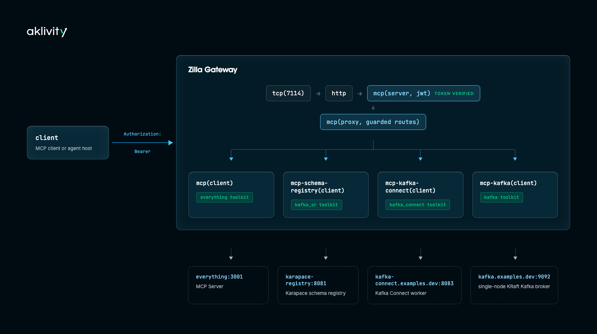

# mcp.kafka.ecosystem.proxy

An MCP (Model Context Protocol) gateway for the Kafka ecosystem. One Streamable HTTP endpoint on port `7114`, secured with JWT, exposes tools for a real Kafka broker, a real Schema Registry, and a real Kafka Connect worker -- no mocks. A small always-available demo toolkit (`everything`) is included too; see the note at the bottom for why.



| Toolkit         | Talks to                    | Scope needed          |
|-----------------|-----------------------------|-----------------------|
| `everything`    | a demo MCP reference server | none                  |
| `kafka_sr`      | Karapace Schema Registry    | `kafka_sr:tools`      |
| `kafka_connect` | a Kafka Connect worker      | `kafka_connect:tools` |
| `kafka`         | the Kafka broker            | `kafka:tools`         |

A tool you're not authorized for simply doesn't appear in `tools/list` -- there's no "visible but denied" state. A few mutating tools need an extra scope on top of toolkit access, e.g. `kafka_sr:write` to register a schema, `kafka_connect:admin` to create a connector, `kafka:write` to produce a message, `kafka:admin` to create/delete topics, `kafka:acls` to manage ACLs.

## Requirements

- docker compose

## Setup

```bash
docker compose up --wait
```

Starts Zilla plus the Kafka broker, Karapace, the Kafka Connect worker, and the demo MCP server.

## Mint a JWT

```bash
export JWT_TOKEN=$(docker compose run --rm jwt-cli encode \
    --alg "RS256" --kid "example" \
    --iss "https://auth.example.com" --aud "https://api.example.com" \
    --exp=+1d --no-iat \
    --payload "scope=kafka_sr:tools kafka_sr:write kafka_connect:tools kafka_connect:admin kafka:tools kafka:write kafka:admin kafka:acls" \
    --secret @/private.pem | tr -d '\r\n')
```

Drop scopes from `--payload` to see the matching tools disappear from `tools/list`.

## Register the gateway with Claude Code

```bash
claude mcp add zilla-mcp-gateway --transport http http://localhost:7114/mcp \
    --header "Authorization: Bearer $JWT_TOKEN"
```

Confirm it connected with `claude mcp list` or `/mcp`, then just ask:

```text
What zilla-mcp-gateway tools do you already have available?
```

**Schema registry (`kafka_sr` toolkit):**

```text
Register an AVRO schema for subject orders-value with one field, id (string)
List every subject registered in the schema registry
Describe subject orders-value in the schema registry
Get the latest schema for subject orders-value
Set the compatibility level of orders-value to FULL
What compatibility level is configured for orders-value?
Check whether {"type":"record","name":"Order","fields":[{"name":"id","type":"string"}]} is compatible with version 1 of orders-value
Delete version 1 of the orders-value subject
Delete the orders-value subject entirely
```

**Kafka Connect (`kafka_connect` toolkit):**

```text
What connector plugins are available on the Kafka Connect worker?
Create a FileStreamSourceConnector named file-source-demo reading /tmp/kc-source.txt into topic connect-demo
List every connector currently running on Kafka Connect
Describe the file-source-demo connector
Show me the file-source-demo connector's config
Validate this FileStreamSourceConnector config before creating it: {"connector.class":"org.apache.kafka.connect.file.FileStreamSourceConnector","tasks.max":"1","file":"/tmp/kc-source.txt","topic":"connect-demo"}
What's the status of the file-source-demo connector?
List the tasks for the file-source-demo connector
Update the file-source-demo connector's tasks.max to 2
Pause the file-source-demo connector
Resume the file-source-demo connector
Restart the file-source-demo connector
Restart task 0 of the file-source-demo connector
Describe the committed offsets for the file-source-demo connector
Reset the offsets for the file-source-demo connector
Stop the file-source-demo connector
Delete the file-source-demo connector
```

**Kafka broker (`kafka` toolkit):**

```text
Produce a message "hello from mcp-kafka" to the orders topic
Consume 1 message back from the orders topic
Create a new topic called widgets with 1 partition and replication factor 1
Delete the widgets topic
List every topic on the broker
Describe the orders topic in detail
Describe the effective configs for the orders topic
Change the orders topic's cleanup.policy to compact
Describe the broker's own configs
Change the broker's log retention config
Give me a cluster overview
List the brokers in this cluster
Describe the cluster
List the ACLs on the orders topic
Grant User:bob read access to the orders topic
Revoke User:bob's read access to the orders topic
List consumer groups
Describe the orders-analytics consumer group
What's the lag for the orders-analytics consumer group?
Reset the orders-analytics consumer group's offset for orders partition 0 to 0
```

## Try it with the MCP Inspector

```bash
npx @modelcontextprotocol/inspector http://localhost:7114/mcp
```

Or with the bundled headless client:

```bash
docker compose run --rm -e JWT_TOKEN="$JWT_TOKEN" tools-list-client
```

## Try it from the command line

### Schema Registry

```bash
docker compose run --rm -e JWT_TOKEN="$JWT_TOKEN" \
    -e CALL_TOOL=kafka_sr__register_schema \
    -e CALL_ARGS='{"subject":"orders-value","schemaType":"AVRO","schema":"{\"type\":\"record\",\"name\":\"Order\",\"fields\":[{\"name\":\"id\",\"type\":\"string\"}]}"}' \
    tools-list-client
# Registered schema with id 1

docker compose run --rm -e JWT_TOKEN="$JWT_TOKEN" \
    -e CALL_TOOL=kafka_sr__list_subjects tools-list-client
# ["orders-value"]

docker compose run --rm -e JWT_TOKEN="$JWT_TOKEN" \
    -e CALL_TOOL=kafka_sr__describe_subject \
    -e CALL_ARGS='{"subject":"orders-value"}' \
    tools-list-client
# [1]

docker compose run --rm -e JWT_TOKEN="$JWT_TOKEN" \
    -e CALL_TOOL=kafka_sr__get_schema \
    -e CALL_ARGS='{"subject":"orders-value","version":"latest"}' \
    tools-list-client
# Retrieved schema id 1, version 1

docker compose run --rm -e JWT_TOKEN="$JWT_TOKEN" \
    -e CALL_TOOL=kafka_sr__set_compatibility \
    -e CALL_ARGS='{"subject":"orders-value","compatibility":"FULL"}' \
    tools-list-client
# Compatibility level set to FULL

docker compose run --rm -e JWT_TOKEN="$JWT_TOKEN" \
    -e CALL_TOOL=kafka_sr__get_compatibility \
    -e CALL_ARGS='{"subject":"orders-value"}' \
    tools-list-client
# Compatibility level is FULL

docker compose run --rm -e JWT_TOKEN="$JWT_TOKEN" \
    -e CALL_TOOL=kafka_sr__check_compatibility \
    -e CALL_ARGS='{"subject":"orders-value","version":"1","schemaType":"AVRO","schema":"{\"type\":\"record\",\"name\":\"Order\",\"fields\":[{\"name\":\"id\",\"type\":\"string\"}]}"}' \
    tools-list-client
# Compatibility check result: true

docker compose run --rm -e JWT_TOKEN="$JWT_TOKEN" \
    -e CALL_TOOL=kafka_sr__delete_schema_version \
    -e CALL_ARGS='{"subject":"orders-value","version":"1"}' \
    tools-list-client
# Deleted version 1

docker compose run --rm -e JWT_TOKEN="$JWT_TOKEN" \
    -e CALL_TOOL=kafka_sr__delete_subject \
    -e CALL_ARGS='{"subject":"orders-value"}' \
    tools-list-client
# Deleted subject orders-value
```

### Kafka Connect

```bash
docker compose run --rm -e JWT_TOKEN="$JWT_TOKEN" \
    -e CALL_TOOL=kafka_connect__list_connector_plugins tools-list-client
# org.apache.kafka.connect.file.FileStreamSinkConnector
# org.apache.kafka.connect.file.FileStreamSourceConnector

docker compose run --rm -e JWT_TOKEN="$JWT_TOKEN" \
    -e CALL_TOOL=kafka_connect__create_connector \
    -e CALL_ARGS='{"name":"file-source-demo","config":{"connector.class":"org.apache.kafka.connect.file.FileStreamSourceConnector","tasks.max":"1","file":"/tmp/kc-source.txt","topic":"connect-demo"}}' \
    tools-list-client
# Created connector file-source-demo

docker compose run --rm -e JWT_TOKEN="$JWT_TOKEN" \
    -e CALL_TOOL=kafka_connect__list_connectors tools-list-client
# ["file-source-demo"]

docker compose run --rm -e JWT_TOKEN="$JWT_TOKEN" \
    -e CALL_TOOL=kafka_connect__describe_connector \
    -e CALL_ARGS='{"connector":"file-source-demo"}' \
    tools-list-client

docker compose run --rm -e JWT_TOKEN="$JWT_TOKEN" \
    -e CALL_TOOL=kafka_connect__describe_connector_config \
    -e CALL_ARGS='{"connector":"file-source-demo"}' \
    tools-list-client

docker compose run --rm -e JWT_TOKEN="$JWT_TOKEN" \
    -e CALL_TOOL=kafka_connect__validate_connector_config \
    -e CALL_ARGS='{"connector_class":"FileStreamSourceConnector","config":{"connector.class":"org.apache.kafka.connect.file.FileStreamSourceConnector","tasks.max":"1","file":"/tmp/kc-source.txt","topic":"connect-demo"}}' \
    tools-list-client

docker compose run --rm -e JWT_TOKEN="$JWT_TOKEN" \
    -e CALL_TOOL=kafka_connect__describe_connector_status \
    -e CALL_ARGS='{"connector":"file-source-demo"}' \
    tools-list-client
# Connector file-source-demo is RUNNING

docker compose run --rm -e JWT_TOKEN="$JWT_TOKEN" \
    -e CALL_TOOL=kafka_connect__list_connector_tasks \
    -e CALL_ARGS='{"connector":"file-source-demo"}' \
    tools-list-client

docker compose run --rm -e JWT_TOKEN="$JWT_TOKEN" \
    -e CALL_TOOL=kafka_connect__update_connector_config \
    -e CALL_ARGS='{"connector":"file-source-demo","config":{"connector.class":"org.apache.kafka.connect.file.FileStreamSourceConnector","tasks.max":"2","file":"/tmp/kc-source.txt","topic":"connect-demo"}}' \
    tools-list-client

docker compose run --rm -e JWT_TOKEN="$JWT_TOKEN" \
    -e CALL_TOOL=kafka_connect__pause_connector \
    -e CALL_ARGS='{"connector":"file-source-demo"}' \
    tools-list-client

docker compose run --rm -e JWT_TOKEN="$JWT_TOKEN" \
    -e CALL_TOOL=kafka_connect__resume_connector \
    -e CALL_ARGS='{"connector":"file-source-demo"}' \
    tools-list-client

docker compose run --rm -e JWT_TOKEN="$JWT_TOKEN" \
    -e CALL_TOOL=kafka_connect__restart_connector \
    -e CALL_ARGS='{"connector":"file-source-demo"}' \
    tools-list-client

docker compose run --rm -e JWT_TOKEN="$JWT_TOKEN" \
    -e CALL_TOOL=kafka_connect__restart_connector_task \
    -e CALL_ARGS='{"connector":"file-source-demo","task":0}' \
    tools-list-client

docker compose run --rm -e JWT_TOKEN="$JWT_TOKEN" \
    -e CALL_TOOL=kafka_connect__describe_connector_offsets \
    -e CALL_ARGS='{"connector":"file-source-demo"}' \
    tools-list-client

docker compose run --rm -e JWT_TOKEN="$JWT_TOKEN" \
    -e CALL_TOOL=kafka_connect__stop_connector \
    -e CALL_ARGS='{"connector":"file-source-demo"}' \
    tools-list-client

docker compose run --rm -e JWT_TOKEN="$JWT_TOKEN" \
    -e CALL_TOOL=kafka_connect__reset_connector_offsets \
    -e CALL_ARGS='{"connector":"file-source-demo"}' \
    tools-list-client

docker compose run --rm -e JWT_TOKEN="$JWT_TOKEN" \
    -e CALL_TOOL=kafka_connect__delete_connector \
    -e CALL_ARGS='{"connector":"file-source-demo"}' \
    tools-list-client
```

### Kafka

```bash
docker compose run --rm -e JWT_TOKEN="$JWT_TOKEN" \
    -e CALL_TOOL=kafka__produce_message \
    -e CALL_ARGS='{"topic":"orders","value":"hello from mcp-kafka"}' \
    tools-list-client
# Produced record to orders topic

docker compose run --rm -e JWT_TOKEN="$JWT_TOKEN" \
    -e CALL_TOOL=kafka__consume_messages \
    -e CALL_ARGS='{"topic":"orders","limit":1}' \
    tools-list-client
# Consumed 1 messages from topic orders

docker compose run --rm -e JWT_TOKEN="$JWT_TOKEN" \
    -e CALL_TOOL=kafka__create_topics \
    -e CALL_ARGS='{"topics":[{"topic":"widgets","partitions":1,"replicas":1}]}' \
    tools-list-client
# Created topic(s): widgets

docker compose run --rm -e JWT_TOKEN="$JWT_TOKEN" \
    -e CALL_TOOL=kafka__delete_topics \
    -e CALL_ARGS='{"topics":["widgets"]}' \
    tools-list-client
# Deleted topic(s): widgets

docker compose run --rm -e JWT_TOKEN="$JWT_TOKEN" \
    -e CALL_TOOL=kafka__list_topics tools-list-client
# Found 1 topic(s)

docker compose run --rm -e JWT_TOKEN="$JWT_TOKEN" \
    -e CALL_TOOL=kafka__describe_topic \
    -e CALL_ARGS='{"topic":"orders"}' \
    tools-list-client
# Described topic orders

docker compose run --rm -e JWT_TOKEN="$JWT_TOKEN" \
    -e CALL_TOOL=kafka__describe_topic_configs \
    -e CALL_ARGS='{"topic":"orders"}' \
    tools-list-client

docker compose run --rm -e JWT_TOKEN="$JWT_TOKEN" \
    -e CALL_TOOL=kafka__alter_topic_configs \
    -e CALL_ARGS='{"topic":"orders","configs":{"cleanup.policy":"compact"}}' \
    tools-list-client
# Updated configs for topic orders

docker compose run --rm -e JWT_TOKEN="$JWT_TOKEN" \
    -e CALL_TOOL=kafka__describe_broker_configs \
    -e CALL_ARGS='{"broker_id":1}' \
    tools-list-client

docker compose run --rm -e JWT_TOKEN="$JWT_TOKEN" \
    -e CALL_TOOL=kafka__alter_broker_configs \
    -e CALL_ARGS='{"broker_id":1,"configs":{"log.retention.hours":"48"}}' \
    tools-list-client

docker compose run --rm -e JWT_TOKEN="$JWT_TOKEN" \
    -e CALL_TOOL=kafka__cluster_overview tools-list-client
# Cluster overview: 1 topic(s), 1 broker(s)

docker compose run --rm -e JWT_TOKEN="$JWT_TOKEN" \
    -e CALL_TOOL=kafka__list_brokers tools-list-client
# Brokers: 1@kafka.examples.dev:29092

docker compose run --rm -e JWT_TOKEN="$JWT_TOKEN" \
    -e CALL_TOOL=kafka__describe_cluster tools-list-client

docker compose run --rm -e JWT_TOKEN="$JWT_TOKEN" \
    -e CALL_TOOL=kafka__list_acls \
    -e CALL_ARGS='{"resource_type":"topic","resource_name":"orders"}' \
    tools-list-client

docker compose run --rm -e JWT_TOKEN="$JWT_TOKEN" \
    -e CALL_TOOL=kafka__create_acls \
    -e CALL_ARGS='{"acls":[{"resource_type":"topic","resource_name":"orders","principal":"User:bob","operation":"read","permission_type":"allow"}]}' \
    tools-list-client

docker compose run --rm -e JWT_TOKEN="$JWT_TOKEN" \
    -e CALL_TOOL=kafka__delete_acls \
    -e CALL_ARGS='{"acls":[{"resource_type":"topic","resource_name":"orders","principal":"User:bob"}]}' \
    tools-list-client

docker compose run --rm -e JWT_TOKEN="$JWT_TOKEN" \
    -e CALL_TOOL=kafka__list_consumer_groups tools-list-client
# No consumer groups found

docker compose run --rm -e JWT_TOKEN="$JWT_TOKEN" \
    -e CALL_TOOL=kafka__describe_consumer_group \
    -e CALL_ARGS='{"group_id":"orders-analytics"}' \
    tools-list-client
# Consumer group orders-analytics is Dead

docker compose run --rm -e JWT_TOKEN="$JWT_TOKEN" \
    -e CALL_TOOL=kafka__describe_consumer_group_lag \
    -e CALL_ARGS='{"group_id":"orders-analytics"}' \
    tools-list-client
# Consumer group orders-analytics has total lag 0

docker compose run --rm -e JWT_TOKEN="$JWT_TOKEN" \
    -e CALL_TOOL=kafka__reset_offsets \
    -e CALL_ARGS='{"group_id":"orders-analytics","topic":"orders","partition":0,"offset":0}' \
    tools-list-client
```

Every tool each toolkit exposes -- schema versioning and compatibility checks, connector pause/resume/restart, topic/ACL/consumer-group management -- works the same way: pick a `CALL_TOOL` from `tools/list` and pass its `CALL_ARGS` as JSON.

## Teardown

```bash
docker compose down -v
```

## References

- [Zilla docs -- `mcp` bindings](https://docs.aklivity.io/latest/reference/2.x/config/bindings/mcp/)
- [Zilla docs -- `mcp-schema-registry` binding](https://docs.aklivity.io/latest/reference/2.x/config/bindings/mcp-schema-registry/)
- [Zilla docs -- `mcp-kafka-connect` binding](https://docs.aklivity.io/latest/reference/2.x/config/bindings/mcp-kafka-connect/)
- [Zilla docs -- `mcp-kafka` binding](https://docs.aklivity.io/latest/reference/2.x/config/bindings/mcp-kafka/)
- [Zilla docs -- `jwt` guard](https://docs.aklivity.io/latest/reference/2.x/config/guards/jwt.html)
